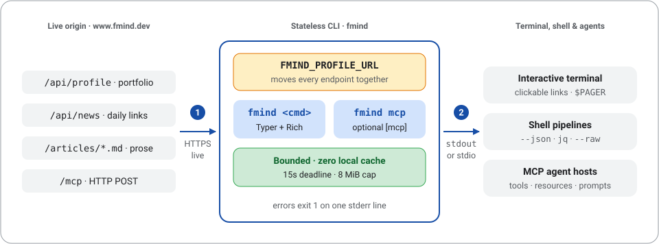

# fmind

Read [Médéric Hurier's (Fmind)](https://www.fmind.dev/) portfolio and daily tech news from the terminal, or bridge its `/mcp` server over stdio.

[](https://github.com/fmind/cli/actions/workflows/ci.yml) [](https://pypi.org/project/fmind/) [](https://pypi.org/project/fmind/) [](https://github.com/fmind/cli/blob/main/LICENSE)

<a href="https://raw.githubusercontent.com/fmind/cli/main/docs/assets/overview.svg">
  .md, and /mcp) flow through the stateless fmind CLI (15s deadline, 8 MiB limit, zero local cache) to Rich terminal cards, --json / --raw shell pipelines, and MCP over stdio."
    width="960"
  >
</a>

## Install

Requires Python 3.14+ and HTTPS access to `www.fmind.dev`. Run immediately with [uv](https://docs.astral.sh/uv/) (which provisions Python 3.14+ automatically), or install persistently:

```bash
uvx fmind
```

```text
Name         Médéric Hurier (Fmind)
Role         Freelance AI Architect
Headline     Freelance AI Architect • AI Agents, MLOps & Security
…
Contact      contact@fmind.dev
Website      https://www.fmind.dev
…

fmind --help lists every command.
```

```bash
uv tool install fmind         # portfolio and news commands
uv tool install 'fmind[mcp]'  # include the stdio MCP bridge
pipx install fmind            # alternative (requires a local Python 3.14+ interpreter)
```

## Commands

| Command                                               | Shows                                                     |
| ----------------------------------------------------- | --------------------------------------------------------- |
| `fmind`                                               | The `whoami` card and a pointer to `--help`               |
| `fmind whoami`                                        | Name, headline, location, experience, availability, links |
| `fmind about`                                         | The biography                                             |
| `fmind skills`                                        | Core expertise, as published on the site                  |
| `fmind experiences`                                   | Engagements in website order                              |
| `fmind certifications`                                | Certifications, the PhD, specializations                  |
| `fmind community`                                     | Ambassador and advisory roles                             |
| `fmind papers`                                        | The doctorate and the peer-reviewed papers, with code     |
| `fmind projects [--limit <n>]`                        | Open-source projects and video series, with code          |
| `fmind sites`                                         | Interactive tools published alongside the writing         |
| `fmind articles [--limit <n>]`                        | The most recent writing                                   |
| `fmind search [query...] [--tag <tag>] [--limit <n>]` | Articles matching every term, newest first                |
| `fmind read <slug> [--raw]`                           | One article, rendered in the terminal                     |
| `fmind tags`                                          | The article tags, with counts and `search --tag` hints    |
| `fmind news [query...] [--limit <n>]`                 | Daily curated links, newest edition first                 |
| `fmind hire`                                          | What can be booked right now                              |
| `fmind mcp`                                           | Stdio MCP bridge to `www.fmind.dev/mcp` (`fmind[mcp]`)    |

Commands mirror the website's `/api/profile` and `/api/news` sections and stay stable across visual redesigns.

- `--limit` (`1`–`200`) bounds `articles` (`6`), `search` (`10`), `news` editions (`1`, or `10` with terms), and each `projects` list (`6`).
- `--json` works on bare `fmind` and before or after every command except `mcp` (`fmind --json experiences` or `fmind experiences --json`). It takes precedence over `read --raw` and stores the source in `markdown`.
- Global `--color` / `--no-color` (auto-detected, respecting `NO_COLOR` and redirects) and `--version` go before the command; `-h` / `--help` works on `fmind` and every subcommand.

### Reading

`fmind search` ANDs terms case-insensitively across titles, summaries, tags, and slugs. `--tag` restricts to a published site tag (unknown tags fail and list valid ones).

```bash
fmind search agent security
fmind search --tag MLOps --limit 3
```

`fmind read` accepts an exact or unambiguous partial slug and pages long output via `$PAGER` (`less` by default; set `PAGER=cat` to print directly). Pass `--raw` for the Markdown source.

```bash
slug="$(fmind articles --limit 1 --json | jq -r '.[0].slug')"
fmind read "$slug"
fmind read "$slug" --raw | glow -
```

### News

`fmind news` shows the latest daily edition of curated AI agent, Python, security, and cloud links. Terms AND-match link titles, domains, summaries, URLs, and edition dates or topics (`2026-11-06`, `2026-11`); `--limit` defaults to `1` (`10` when searching).

```bash
fmind news                  # latest edition
fmind news --limit 7        # past week
fmind news agent security   # matching links, newest edition first
fmind news 2026-11-06       # one edition
```

### Piping

`--json` writes undecorated JSON to stdout and errors to stderr:

```bash
fmind articles --limit 20 --json | jq -r '.[] | "\(.date[:10])  \(.title)"'
fmind certifications --json | jq -r '.certifications[] | select(.active) | .title'
fmind news --limit 7 --json | jq -r '.[].items[] | "\(.domain)  \(.title)"'
```

Grouped JSON schemas:

- `whoami --json`: `metadata`, `experience` (featured engagement, or `[]`), and `services`.
- `certifications --json`: `certifications`, `thesis`, and `specializations`.
- `papers --json`: `thesis` and `papers`.
- `projects --json`: `open_source` and `youtube_series` (each bounded by `--limit`).
- `news --json`: editions, keeping only matching `items` when searching.
- `read <slug> --json`: article index fields plus `slug` and `markdown`.

## MCP over stdio

Portfolio commands require only Typer and Rich; the optional `mcp` extra adds the [official MCP Python SDK](https://py.sdk.modelcontextprotocol.io/):

```json
{
  "mcpServers": {
    "fmind": {
      "command": "uvx",
      "args": ["--from", "fmind[mcp]", "fmind", "mcp"]
    }
  }
}
```

- Bridges `https://www.fmind.dev/mcp` (or the `FMIND_PROFILE_URL` origin) over protocol-only stdio with no local caching (`--json` is rejected; startup errors go to stderr).
- Forwards read-only tools, resources, and prompts (no subscriptions, sampling, or elicitation).
- Enforces a 15s deadline and 8 MiB response cap per call, isolating individual failures without stopping the bridge.

## Development

```bash
mise install && mise run install  # toolchain, locked venv, and git hooks
mise run all                      # check, test, build (non-mutating CI gate)
mise run format                   # format Python, JSON, Markdown, TOML, YAML
mise run smoke                    # live API/article and MCP compatibility check
```

Override `FMIND_PROFILE_URL` to point profile, news, article reads, and `/mcp` at another origin (such as a local dev server):

```bash
FMIND_PROFILE_URL=http://127.0.0.1:8080/api/profile fmind whoami
```

Run `mise tasks` for individual checks, and see [AGENTS.md](https://github.com/fmind/cli/blob/main/AGENTS.md) for invariants and release details.

## Support & Security

See the [Changelog](https://github.com/fmind/cli/blob/main/CHANGELOG.md) for release notes, open bug reports in [Issues](https://github.com/fmind/cli/issues), and report vulnerabilities via the [Security policy](https://github.com/fmind/cli/security/policy).

## License

[MIT](https://github.com/fmind/cli/blob/main/LICENSE), © 2026 Médéric Hurier (Fmind).
