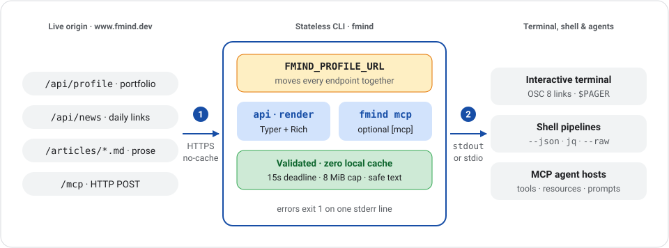

# fmind

Read [Médéric Hurier's (Fmind)](https://www.fmind.dev/) portfolio and daily tech news from the terminal, or bridge its `/mcp` server over stdio.

[](https://github.com/fmind/cli/actions/workflows/ci.yml) [](https://pypi.org/project/fmind/) [](https://pypi.org/project/fmind/) [](https://github.com/fmind/cli/blob/main/LICENSE)

<a href="https://raw.githubusercontent.com/fmind/cli/main/docs/assets/overview.svg">
  .md, and /mcp) flow through the stateless fmind CLI (strict validation, 15s / 8 MiB bounds, zero local cache) to Rich terminal cards, --json / --raw shell pipelines, and MCP over stdio."
    width="960"
  >
</a>

## Install

Run immediately with [uv](https://docs.astral.sh/uv/), or install persistently:

```console
$ uvx fmind
Name         Médéric Hurier (Fmind)
Role         Freelance AI Architect
Headline     Freelance AI Architect • AI Agents, MLOps & Security
…
Contact      contact@fmind.dev
Website      https://www.fmind.dev
…

fmind --help lists every command.
```

```bash
uv tool install fmind         # portfolio and news commands
uv tool install 'fmind[mcp]'  # include the stdio MCP bridge
pipx install fmind            # alternative
```

Override `FMIND_PROFILE_URL` to point profile, news, article reads, and `/mcp` at another origin (such as local `mise run watch`):

```bash
FMIND_PROFILE_URL=http://127.0.0.1:8080/api/profile fmind whoami
```

## Commands

| Command                                        | Shows                                                     |
| ---------------------------------------------- | --------------------------------------------------------- |
| `fmind`                                        | The `whoami` card and a pointer to `--help`               |
| `fmind whoami`                                 | Name, headline, location, experience, availability, links |
| `fmind about`                                  | The biography                                             |
| `fmind skills`                                 | Core expertise, as published on the site                  |
| `fmind experiences`                            | Engagements in website order                              |
| `fmind certifications`                         | Certifications, the PhD, specializations                  |
| `fmind community`                              | Ambassador and advisory roles                             |
| `fmind papers`                                 | The doctorate and the peer-reviewed papers, with code     |
| `fmind projects [--limit 6]`                   | Open-source projects and video series, with code          |
| `fmind sites`                                  | Interactive tools published alongside the writing         |
| `fmind articles [--limit 6]`                   | The most recent writing                                   |
| `fmind search [query...] [--tag] [--limit 10]` | Articles matching every term, newest first                |
| `fmind read <slug> [--raw]`                    | One article, rendered in the terminal                     |
| `fmind tags`                                   | The article tags, with counts and their `search --tag`    |
| `fmind news [query...] [--limit]`              | Daily curated links, newest edition first                 |
| `fmind hire`                                   | What can be booked right now                              |

Commands mirror the website's `/api/profile` and `/api/news` sections and stay stable across visual redesigns.

- `--limit` (`1`–`200`) bounds `articles`, `search`, `news` editions, and each `projects` list (`open_source` and `youtube_series`).
- `--json` works before or after any portfolio command (`fmind --json experiences` or `fmind experiences --json`) and takes precedence over `read --raw` (storing the source in `markdown`). Pipe to `jq` for custom filters.
- Global `--color` / `--no-color` (auto-detected, respecting `NO_COLOR` and redirects) and `--version` go before the command.
- Output uses terminal-default text and a blue accent, stacked entries for narrow widths, unwrapped OSC 8 links, and no trailing whitespace when redirected.

### Reading

`fmind search` ANDs terms case-insensitively across titles, summaries, tags, and slugs. `--tag` restricts to a published site tag (unknown tags fail and list valid ones).

```bash
fmind search agent security
fmind search --tag MLOps --limit 3
```

`fmind read` accepts an exact or unambiguous partial slug. On interactive terminals with a known non-`dumb` `TERM`, it pages via `$PAGER` (`less` with `LESS=FRX` unless `LESS` is set); `PAGER=cat` or a missing/unparsable `PAGER` prints directly, and pager launch or exit failures report an error (`PAGER=cat` retries without paging). `--raw` prints the Markdown source.

```bash
slug="$(fmind articles --limit 1 --json | jq -r '.[0].slug')"
fmind read "$slug"
fmind read "$slug" --raw | glow -
```

### News

`fmind news` shows the latest daily edition of curated AI agent, Python, security, and cloud links. Terms AND-match link titles, domains, summaries, URLs, and edition dates or topics (`2026-11-06`, `2026-11`); `--limit` defaults to `1` (`10` when searching).

```bash
fmind news                  # latest edition
fmind news --limit 7        # past week
fmind news agent security   # matching links, newest edition first
fmind news 2026-11-06       # one edition
```

### Piping

`--json` writes undecorated JSON to stdout and errors to stderr:

```bash
fmind articles --limit 20 --json | jq -r '.[] | "\(.date[:10])  \(.title)"'
fmind certifications --json | jq -r '.certifications[] | select(.active) | .title'
fmind news --limit 7 --json | jq -r '.[].items[] | "\(.domain)  \(.title)"'
```

`whoami --json` returns `metadata`, `experience` (the featured engagement, or `[]`), and `services`. `certifications --json` groups `certifications`, `thesis`, and `specializations`. `projects --json` groups `open_source` and `youtube_series` (each bounded by `--limit`). `news --json` lists editions, keeping only matching `items` when searching.

## MCP over stdio

Portfolio commands require only Typer and Rich; the optional `mcp` extra adds the [official MCP Python SDK](https://py.sdk.modelcontextprotocol.io/) (`uv tool install 'fmind[mcp]'` or `uv run --extra mcp fmind mcp` from a checkout):

```json
{
  "mcpServers": {
    "fmind": {
      "command": "uvx",
      "args": ["--from", "fmind[mcp]", "fmind", "mcp"]
    }
  }
}
```

`fmind mcp` bridges `https://www.fmind.dev/mcp` (or the `FMIND_PROFILE_URL` origin) from Streamable HTTP to protocol-only stdio without local caching (`--json` is rejected; startup errors go to stderr). Upstream MCP requests use finite JSON POSTs (`405` with `Allow: POST` on GET/HEAD; use `/health` for probes) and forward read-only tools, resources, and prompts (no subscriptions, sampling, or elicitation). Each exchange has a `15s` deadline and `8 MiB` response cap, failing individually without stopping the bridge.

## Development

```bash
mise install && mise run install  # toolchain, locked venv, and git hooks
mise run all                      # format, check, test, build (CI gate)
mise run smoke                    # live API/article and MCP compatibility check
```

`mise tasks` lists individual `format`, `check` (`check:local` pre-commit; `check:network` + `test` pre-push), `test`, and `build` tasks. CI runs `mise run all` on Python 3.15, tests Python 3.14, and checks declared floors with `--resolution lowest-direct` on Python 3.14. Release tags (`vX.Y.Z` matching `pyproject.toml` and `CHANGELOG.md`) rerun CI and `mise run smoke` in CD before publishing automatically to PyPI Trusted Publishing and GitHub Releases.

## License

[MIT](https://github.com/fmind/cli/blob/main/LICENSE) — © 2026 Médéric Hurier (Fmind).
